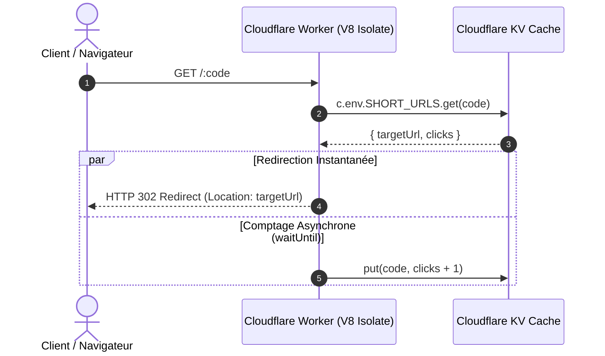

# ⚡ cf-edge-shortlink

> Micro-service Serverless de réduction d'URL à ultra-basse latence, propulsé par **Cloudflare Workers (V8 Isolates)** et stocké sur **Cloudflare KV (Key-Value distribué)**.

---

## 🏛️ Architecture & Fonctionnement

Contrairement à un serveur classique (Node.js/Express sur VM ou VPS) centralisé dans une seule région géographique, ce service tourne sur l'**Edge** de Cloudflare (réseau mondial de plus de 300 datacenters).



### Points clés d'ingénierie (GL / Infra)
* **V8 Isolates :** Démarrage à froid (*cold start*) quasi nul (< 5ms) comparé à un conteneur Docker.
* **Non-blocking analytics :** Utilisation de `c.executionCtx.waitUntil()` pour différer l'écriture des clics dans le KV et renvoyer la redirection sans aucune milliseconde de latence perçue par l'utilisateur.
* **Framework Hono :** Routeur ultra-léger et typé, standard de l'industrie pour les runtimes Edge.

---

## 🛠️ Stack Technique

* **Runtime :** Cloudflare Workers
* **Framework :** [Hono](https://hono.dev/)
* **Langage :** TypeScript (mode strict)
* **Base de données :** Cloudflare Workers KV
* **Générateur de slug :** Nanoid (base62, 7 caractères)
* **CLI & Déploiement :** Wrangler

---

## 📡 Spécification des Endpoints (API REST)

| Méthode | Route | Description | Statut HTTP |
| :--- | :--- | :--- | :--- |
| `GET` | `/` | Informations du service et endpoints | `200 OK` |
| `POST` | `/shorten` | Création d'un lien court | `201 Created` / `400 Bad Request` |
| `GET` | `/:code` | Redirection immédiate vers l'URL d'origine | `302 Found` / `404 Not Found` |
| `GET` | `/stats/:code` | Métriques du lien (clics, date de création) | `200 OK` / `404 Not Found` |

---

## 🚀 Démarrage Rapide

### 1. Installation des dépendances
```bash
npm install
```

### 2. Lancer en local
```bash
npx wrangler dev
```
Le serveur local démarre sur `http://127.0.0.1:8787`.

---

## 🧪 Exemples d'appels API (cURL)

### 1. Créer une URL courte
```bash
curl -X POST http://127.0.0.1:8787/shorten \
  -H "Content-Type: application/json" \
  -d '{"url":"https://github.com/riadhakuma"}'
```

**Réponse :**
```json
{
  "code": "2pxbE6q",
  "shortUrl": "http://127.0.0.1:8787/2pxbE6q",
  "targetUrl": "https://github.com/riadhakuma"
}
```

### 2. Suivre la redirection
Ouvrez directement `http://127.0.0.1:8787/2pxbE6q` dans votre navigateur ou via cURL :
```bash
curl -i http://127.0.0.1:8787/2pxbE6q
```

### 3. Consulter les statistiques
```bash
curl http://127.0.0.1:8787/stats/2pxbE6q
```

**Réponse :**
```json
{
  "code": "2pxbE6q",
  "targetUrl": "https://github.com/riadhakuma",
  "clicks": 1,
  "createAt": "2026-11-02T14:58:07.014Z"
}
```

---

## 🌍 Déploiement en Production sur Cloudflare

```bash
# 1. Connexion à Cloudflare
npx wrangler login

# 2. Création du KV Namespace de production
npx wrangler kv namespace create SHORT_URLS

# 3. Renseigner l'ID retourné dans wrangler.toml, puis déployer :
npx wrangler deploy
```

---

## 👤 Auteur
* **Riadh Mohamed Gharbi** ([@riadhakuma](https://github.com/riadhakuma)) - ISIL (Systèmes d'Information et Ingénierie Logicielle)
